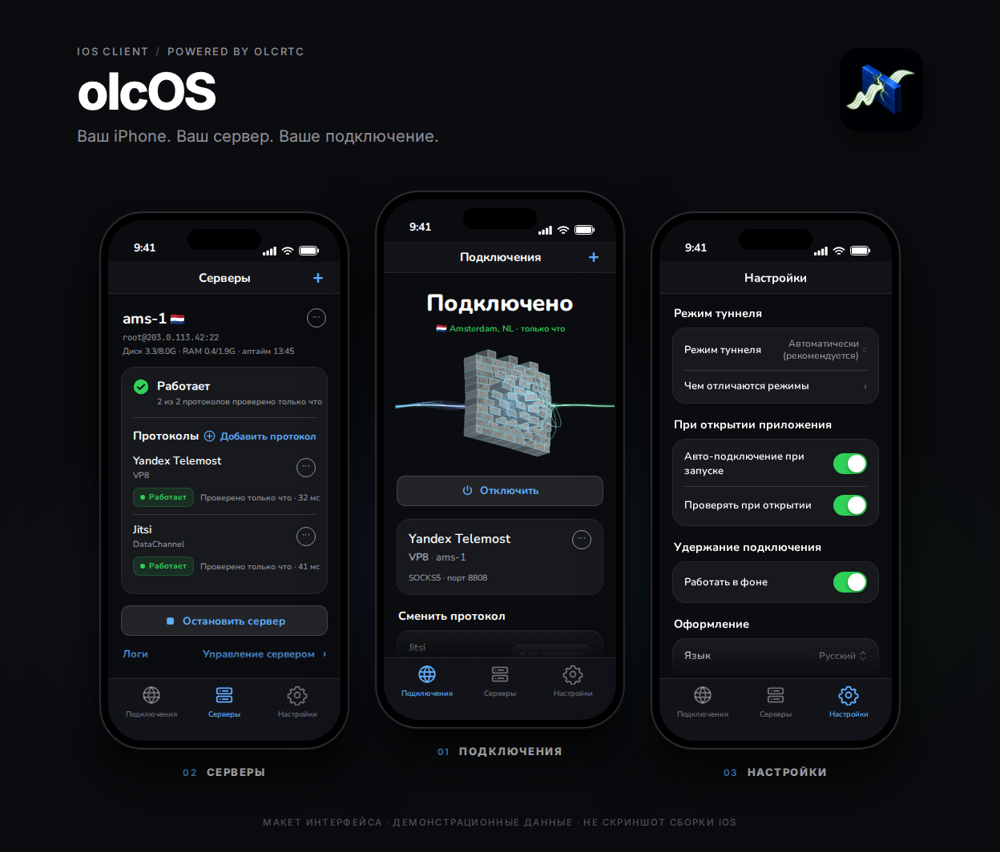

<div align="center">
  <p><a href="README.ru.md">Русский</a> · <strong>English</strong></p>
  
  <h1>olcOS</h1>
  <p><strong>Your iPhone. Your server. Your connection.</strong></p>
  <p>iPhone and iPad on iOS 17+ · Russian, English, French</p>
  <p>
    <a href="#install">Install</a> ·
    <a href="#connect">Connect</a> ·
    <a href="#when-something-does-not-work">Help</a> ·
    <a href="docs/build.md">Build</a>
  </p>
</div>

**olcOS is an iPhone app that takes your internet through your own server.** The traffic travels inside an ordinary video call — Yandex Telemost, Jitsi, SaluteJazz, VK Calls, MTS Link — or straight to the server over Xray (VLESS · REALITY). Connect with a link, a QR code, a file or a subscription, and the app installs your own server for you.

<div align="center">
  
</div>

## What it does

- **Connects in one tap.** Links, QR codes, files, subscriptions and ready-made server lists. The app finds a server that works and moves to another one when it stops answering.
- **Installs your server.** One-tap install over SSH, several protocols on one server, and the "Whole server" connection that bonds the rooms of every protocol so their speeds add up.
- **Shows how the traffic flows.** Home shows each protocol's speed live; the Connection check measures every protocol on its own and all of them together.
- **Sends Russian sites direct.** Banks, government services and other Russian sites open as usual while everything else goes through the tunnel; add your own list too.
- **VPN or proxy.** VPN for the whole phone, or a SOCKS5 proxy for apps that support one — Telegram, Potatso, Shadowrocket.
- **Widgets.** Home Screen, Lock Screen, Control Center and a Live Activity with the speed in the Dynamic Island.
- **Turns itself on.** The VPN can connect by itself on mobile data and on chosen Wi-Fi networks.

## Install

1. Download `olcos-ios-unsigned.ipa` from [Releases](https://github.com/olcOS/olcos/releases) or [build it yourself](docs/build.md).
2. Install it with Sideloadly, AltStore or SideStore.
3. Open olcOS and add a connection.

> **VPN or proxy.** With a free Apple ID, iOS does not let apps run a VPN: the SOCKS5 proxy works. The whole-phone VPN is available when the app is signed with a paid Apple developer account.

### Free Apple ID

- An app signed with a free Apple ID stops opening after 7 days. Re-sign it before then with AltStore, SideStore or Sideloadly (AltStore and SideStore refresh it by themselves while they run).
- AltStore may ask what to do with the app's extensions (the VPN tunnel and the widgets). Remove them: with a free Apple ID neither the VPN nor the widgets work anyway.
- Only the proxy works. After Connect, Home shows the proxy card: tap "Use in Telegram", or give other apps the SOCKS5 address `127.0.0.1` and the port shown on the card (Settings → Advanced → Proxy has the same). Potatso and Shadowrocket also need olcOS's server in their bypass list — the card links to it.

## Connect

1. Tap **+** at the top right: paste a link, scan a QR code, open a file, add a "Link or subscription", or pick "Ready-made lists".
2. Have a server? Two ways. From the app: **+** → "My own server (VPS)", it connects over SSH and installs everything. Or one command on the server itself (Debian, Ubuntu, Fedora; as root):

   ```
   curl -fsSL https://raw.githubusercontent.com/olcOS/olcos/main/install.sh | sudo bash
   ```

   At the end it shows a QR code: an invite with full management. Scan it with olcOS on any phone, iPhone or Android, and that phone becomes the server's owner: rooms, protocols, invites for the family and the core update are done from the app; SSH is not needed again.
3. Tap **Connect**. In proxy mode tap "Use in Telegram", or enter `127.0.0.1` and the app's port in Potatso or Shadowrocket.
4. For the family: on the server card → Share → Invites, one link per device. An invite can also hand over server management; both iPhone and Android accept it.

Connection links carry keys — do not post them.

## Modes

| | VPN | SOCKS5 proxy |
|---|---|---|
| What goes through the tunnel | the whole phone | apps set up with the proxy |
| Needs paid signing | yes | no |
| "Whole server" bonding | trial, up to three rooms | every room |

## Limits

- The VPN carries TCP over IPv4. Apps that need UDP or IPv6 may not work through it.
- Speed depends on your network and on the video-call service. No speed or stealth is promised.
- Use the app within the laws of your country and the rules of the services the traffic travels through.

## When something does not work

| What happened | What to do |
|---|---|
| It does not connect | The Connection check on Home shows which protocol answers. Open a subscription and tap "Find the fastest and connect". |
| It is slow | Measure every protocol in the Connection check and connect to the fastest — or to "Whole server" when bonding adds speed. |
| It says it is using the proxy, not the VPN | The app is signed with a free Apple ID, so iOS refused the VPN permission; olcOS switched to the proxy by itself and remembers that. Home shows the proxy card with "Use in Telegram" and the address for other apps. For the whole-phone VPN, sign the app with a paid developer account and choose VPN in Settings. |
| You need help | Settings → "View all logs" → "Export all logs", then [describe the problem](https://github.com/olcOS/olcos/issues/new/choose). Do not post keys, passwords or full links. |

Found a vulnerability? Report it [privately only](SECURITY.md).

## Build from source

You need macOS with Xcode 15+, XcodeGen, Go and the GitHub CLI.

```bash
gh repo clone olcOS/olcos-ios -- --recurse-submodules
cd olcos-ios
./scripts/build-framework.sh
xcodegen generate --spec project.yml
open olcrtc-ios.xcodeproj
```

Details are in the [build guide](docs/build.md), how the app is put together in the [architecture](docs/architecture.md), and how to contribute in [CONTRIBUTING.md](CONTRIBUTING.md).

## Licenses

olcOS is released under the [MIT](LICENSE) license, Copyright (c) 2026 Hotelk52339. The olcrtc core ([ghostlane-project/olcrtc](https://github.com/ghostlane-project/olcrtc), continuing the archived [openlibrecommunity/olcrtc](https://github.com/openlibrecommunity/olcrtc)) is distributed separately under [Apache-2.0](olcrtc-upstream/LICENSE) with its [NOTICE](olcrtc-upstream/NOTICE); the original upstream license is [WTFPL](olcrtc-upstream/docs/upstream-license-wtfpl.txt).
