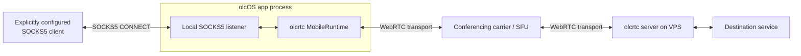
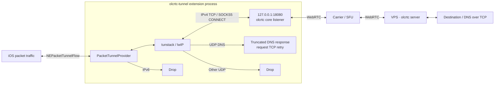
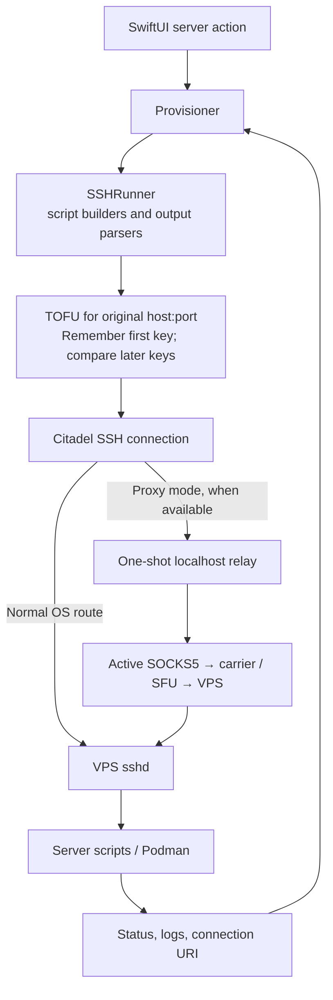

# olcOS architecture

[Overview](../README.md) · [Build](build.md) · [Security](../SECURITY.md)

This page describes implementation boundaries, not field-test results.
The product is **olcOS**; `olcrtc` remains the upstream protocol/core name and
part of compatible internal identifiers. The core comes from
[ghostlane-project/olcrtc](https://github.com/ghostlane-project/olcrtc)
(Apache-2.0), which continues the original
[openlibrecommunity/olcrtc](https://github.com/openlibrecommunity/olcrtc),
archived on 2026-09-30, on the same wire format.

## Components

| Component | Responsibility |
|---|---|
| [`App/`](../App) | SwiftUI composition, connection/server stores, mode selection, SSH administration, diagnostics and localization |
| [`App/Core/TunnelEngine.swift`](../App/Core/TunnelEngine.swift) | Engine abstraction and in-app olcrtc runtime used by proxy mode |
| [`App/Core/TunnelManager.swift`](../App/Core/TunnelManager.swift) | Connection attempts, cancellation, backend ownership, reconnect and diagnostic-route state |
| [`App/Core/VPNController.swift`](../App/Core/VPNController.swift) | System profile lifecycle and observed NE status |
| [`Tunnel/`](../Tunnel) | Separate NetworkExtension process, its own core instance and packet pump |
| [`Widgets/`](../Widgets) · [`Shared/`](../Shared) | Status widget (Home Screen, StandBy, CarPlay, Lock Screen), the iOS 18 Control Centre toggle, and the state and intents they share with the app |
| [`gomobile/tunstack/`](../gomobile/tunstack) | IP-to-SOCKS adapter using Outline SDK's lwIP/transport facilities |
| [`gomobile/bond/`](../gomobile/bond) | Bonding: the client that carries one connection over every lane of a whole-server connection, and the `olcos-bond` server built on the VPS |
| [`olcos-core/`](../olcos-core) | Pinned Go module embedding xray-core (VLESS · REALITY); bound into the same framework as the `olcos` package |
| [`App/Core/XrayEngine.swift`](../App/Core/XrayEngine.swift) · [`Tunnel/XrayTunnelSession.swift`](../Tunnel/XrayTunnelSession.swift) | The xray engine behind `TunnelEngine` (proxy mode) and its tunnel-side session (VPN mode) |
| [`olcrtc-upstream/`](../olcrtc-upstream) | Pinned Go core and upstream installer, consumed during build/parity checks |
| [`scripts/`](../scripts) | Framework build/shims, server operations, packaging and local checks |

`App/Mobile.xcframework` combines upstream mobile, local tunstack and bond and the
olcos-core `olcos` package in one gomobile bind; `VPNConfig.engine` selects
which core a connection attempt drives (`olcrtc` by default, `xray` for a
VLESS · REALITY record). The app and extension each link the framework; they do not
communicate by sharing a single in-app Go runtime.
[Framework build](../scripts/build-framework.sh) · [target dependencies](../project.yml).

## Screens

Three tabs. **Home** ([ConnectionsView](../App/Views/ConnectionsView.swift)) shows
the state, the one connect button and the connection it uses, then diagnostics.
**Servers** ([ConnectionListView](../App/Views/ConnectionListView.swift)) lists
every connection: through video calls, direct (Xray), each of the user's own
servers, and the subscriptions; a row tap connects and returns to Home. "My
servers" ([ServersView](../App/Views/ServersView.swift), `embedded`) is pushed
from that list and holds the SSH administration below. **Settings**
([SettingsView](../App/Views/SettingsView.swift)) shows everything a person uses
in eight visible groups — Connection (mode, connect on launch, check on
opening, background, VPN auto-connect and room bonding), Rooms (auto-update per
protocol, a compact row opening its pickers, and the exceptions), Accounts
(Yandex, VK, MTS Link in place), Network (routing, the addresses another proxy
app must send direct, DNS, the local proxy's login, «В Telegram»), Speed (the
VP8 numbers), Diagnostics (logs), Appearance (theme, language, hidden IP
addresses, widgets) and About (version, licences, reset) — and ends with one
Advanced page for the rare and technical: session timing and checks, the early
restart of a wedged core, the proxy port, how servers are reached, the room
name, the check sources and the log knobs.

The «+» on Home and Servers ([AddSourcesMenu](../App/Views/AddSourcesMenu.swift))
takes a pasted, scanned, typed or file-borne link or list, a ready-made list
([CuratedListsView](../App/Views/CuratedListsView.swift), igareck's free VLESS
lists, re-read hourly; the white lists through Yandex Translate's page proxy) or
the user's own server. Direct servers are ordered working-first; "Find the
fastest" ([BestServerSearch](../App/Services/BestServerSearch.swift)) knocks on
every server over TCP and fully checks the five fastest in turn. Automatic
switching (on by default, proxy mode) moves a failed connection to a sibling
protocol of its server, then to a connection whose last check passed. Checks run
when the app opens (call protocols, the connection in use, the user's own
servers, and up to eight direct servers that worked before) and on every
connect; no screen prints the age of a check.

Checks never move the screen. A row whose value is being re-measured keeps its
last value and spins in the slot of its dot (`HealthCoordinator.settledDisplay`);
statuses sit in slots as wide and tall as every state they can take; a
background result is assigned to a view's state only when it differs from what
the view already shows; the ageing clock redraws only when a verdict crosses a
freshness boundary; and the server agent's change events cause at most one
re-read per 30 s. Only an operation the person started animates a card.

Every screen answers "does it work?" from the same evidence
([ServerStanding](../App/Models/ServerStanding.swift)): a protocol is *working*
when its last check passed within 30 minutes (verified, or fading) or the live
tunnel runs through it, *failed* when its last check ran and found a fault, and
*unchecked* otherwise (never checked, could not be checked, too old). A
protocol whose container the last listing found not running is *stopped*
(`StoppedProtocols`): its row reads «Stopped» in grey, it is not checked
automatically, and it is in no count. The server
card's headline is «Working» when any protocol works, «Not working» only when
every checked protocol failed and none carries the tunnel, «Stopped» when every
protocol is, and «Not checked» when nothing was checked; the protocols that
failed are named under it
(«Not responding: Telemost», two names at most, then «+N»), never averaged into
the colour. The whole-server row stands on its own check and on the rooms it
joins and names the dead ones the same way, and the stopped ones as stopped. The record the live tunnel runs
through reads as working on every screen (`HealthCoordinator.settledDisplay`
asks `TunnelManager` which record that is).

A protocol's page ([ProtocolPageView](../App/Views/ProtocolPageView.swift)) shows
what it started where it started it: a spinner on the control, then one result
line (the success sentence, or the failure that used to be an alert) and a
haptic. «Connect» on it connects and returns to Home through the list's root;
removing the protocol closes the page.

Haptics follow one rule ([DesignSystem](../App/UI/DesignSystem.swift)): a button
(`OlcButton`, `OlcTapButton`, a menu item) gives a light tap after its action
has run and stays silent when the action gave feedback of its own; a changed
choice (segment, chip, switch) gives the selection tick; a finished operation
gives one success or error, and the same outcome is never given twice in a
moment (`HapticPolicy`). Nothing buzzes for automatic recovery or for a
background check.

## Data plane: proxy mode

The app selects the configured port exactly; in-app diagnostic clients use the
live bound endpoint and credentials rather than assuming that a changed
preference already changed a running listener. Proxy readiness alone is not
an end-to-end success: connection verification first checks the listener and
then HTTPS probes through SOCKS.
[TunnelManager](../App/Core/TunnelManager.swift) · [SOCKSSession](../App/Services/SOCKSSession.swift).

Only explicitly configured traffic uses this path. This mode is not a
device-wide VPN, and the app's background audio keeper is separate from
NetworkExtension lifecycle. [BackgroundRuntimeKeeper](../App/Services/BackgroundRuntimeKeeper.swift).

A phone call (or anything else that takes the audio session) interrupts the
keeper, and iOS may suspend the app until it is opened again; a suspended app
can lose its listening socket and its rooms while the session still reads
connected. So whenever the app runs again it runs a **resume check** before
anything else: one loopback connect to the bound SOCKS port (about 1 s), then
one verify probe through it. A port that does not answer restarts the engine on
the same port at once; a failed probe reconnects at once, without waiting for
keep-alive's three misses. Both go through the single recovery sink
(`requestReconnect(immediate:)`), whose own-port wait lets the same port be
rebound after the old listener lets go. The check runs on scene activation
after a stay in the background, when the keeper's audio interruption ends, and
when a keep-alive or heartbeat timer wakes far later than due; only for a
connected proxy session, never after a user disconnect, one at a time and never
beside a running reconnect loop. When an interruption begins the app also asks
iOS for a short background task so work in flight and the log flush can finish.
The decisions are pure helpers on `TunnelManager` (`shouldRunResumeCheck`,
`isSuspensionGap`, `resumeCheckVerdict`), tested in `Tests/ResumeCheckTests.swift`.

## Data plane: VPN mode

The provider installs IPv4 and IPv6 default routes, passes only IPv4 packets
to tunstack and drops IPv6. The SOCKS core supports TCP CONNECT; the packet
adapter uses DNS truncation rather than general UDP forwarding.
The extension's default loopback port is `18080`.
[Provider](../Tunnel/PacketTunnelProvider.swift) · [tunstack](../gomobile/tunstack/tunstack.go) ·
[VPNConfig](../App/Models/VPNConfig.swift).

Provider-originated carrier/resolver sockets use the underlying interface;
the code intentionally does not enable `includeAllNetworks` or add
destination-IP exclusions. This avoids looping the carrier path, but does
not constitute an always-on, all-traffic kill switch.
[Network settings](../Tunnel/PacketTunnelProvider.swift).

The extension uses a no-auth, loopback-only SOCKS listener; loopback is **not**
process-private on iOS. The provider rejects `videochannel` and tunes Go
memory/buffer use for the extension's constrained process budget.
These are code constraints, not measured memory or throughput guarantees.
[Provider initialization](../Tunnel/PacketTunnelProvider.swift).

The core resolver is used from the phone, while the OS DNS resolver's TCP
requests exit through the VPS. `VPNConfig` distinguishes them, maps known
carrier-internal resolver presets for system use, and rejects unsupported
system DNS before routes are installed.
[Resolver policy](../App/Models/VPNConfig.swift).

## Control plane: VPS administration

The relay completes the SOCKS handshake before Citadel begins SSH
authentication. Both direct and relay paths use endpoint-bound TOFU: the
first server key is remembered automatically, then later keys are compared
against that saved trust. The endpoint is the original VPS host and port,
never the relay's ephemeral localhost address. Transport retries can fall
back directly; a changed host key is terminal and must not become a route retry.
[SSHTransport](../App/Core/SSHTransport.swift) · [SSHRunner](../App/Core/SSHRunner.swift) ·
[host-key validator](../App/Core/SSHHostKeyVerification.swift).

A changed key requires an explicit, confirmed trust reset before a later
connection may establish new trust; the validator must never silently replace
it. TOFU checks continuity after first use, not independently verified identity
on the initial connection.
[Trust policy](../App/Core/SSHHostKeyVerification.swift) ·
[reset interface](../App/Views/ServerAdvancedView.swift) (the “Manage server”
screen shows the host-key reset only after a mismatch).

First-use trust is saved before key validation succeeds. Trust is associated
with the canonical host and port rather than a host-record UUID, so recreating
a saved host does not clear it. Trust-store read/write failures stop the
connection instead of accepting a key that cannot be remembered.
[Trust store](../App/Core/SSHHostKeyTrustStore.swift) ·
[verification helpers](../App/Core/SSHHostKeyVerification.swift).

Installation uploads/runs bundled scripts and parses their outputs; ordinary
user traffic does not need an SSH session per request. `srv.sh` uses persistent
deploy directories under `/opt`, Podman containers and the upstream server.
Reinstallation can replace earlier containers/deploy directories.
[Provisioning](../App/Core/Provisioning.swift) · [installer](../scripts/srv.sh).

Adding another carrier uses a sibling configuration/container sharing a deploy
directory, binary and key; key rotation and recovery must preserve the related
script/output contracts.
[Add-carrier script](../scripts/add-carrier.sh) · [key rotation](../scripts/rotate-key.sh).

Device invites hand a server's connections to another device without SSH
access. `InviteSync` builds the list from the records the host links, encrypts
it per invite and uploads it to a busybox httpd container (`olcos-share`) that
serves `/opt/olcos-share/<token>` read-only; it uploads again whenever the list
changes, so a renewed room or rotated key reaches every invited device on its
next refresh. The key stays in the link fragment and the Keychain on both
sides; the invited device fetches with Network.framework and imports the list
as a subscription matched by `##id`.
[Invite model](../App/Models/DeviceInvite.swift) · [sync](../App/Services/InviteSync.swift) ·
[fetcher](../App/Services/InviteFetcher.swift) · [scripts](../App/Core/SSHRunner+Share.swift).

Several rooms at once: `add-carrier.sh` with `OLCRTC_LANE=<n>` runs one more
container of a carrier in its own room (`server-<carrier>-<n>.yaml`,
`<base>-<carrier>-<n>`), sharing the deploy dir and key, so key rotation and
uninstall cover it like any sibling. My servers keeps these lanes apart
from the protocol rows and writes their rooms into the carrier's connection
(`extraRooms`). In proxy mode the engine then runs one core runtime per room on
its own loopback port, and `LaneBalancer` spreads new connections over the
rooms that are running, benching a room whose connections die at once. VPN
mode keeps one room. Telemost lanes are created from the Yandex account like
the main room and renewed together with it.
[Engine](../App/Core/TunnelEngine.swift) · [balancer](../App/Core/LaneBalancer.swift) ·
[script](../scripts/add-carrier.sh).

Room auto-update is one rule per protocol (`RoomRotationRule`). Telemost is Off
or Automatic and is renewed ahead of its 24-hour expiry by
`TelemostRenewalCoordinator`; VK Calls, SaluteJazz, MTS Link and Jitsi, whose
rooms do not expire, are Off or every 6 h, 12 h, day, 3 days or week (saved
Daily and Weekly keep their meaning; an unknown value reads as Off) and are
replaced by `RoomRotationCoordinator`. Beside each schedule sits a window
(`RoomRotationWindow`: any time, night 02:00–06:00 or one chosen hour, by the
phone's clock; nothing saved reads as any time): a room is due when its age
reaches the interval (an hour earlier with a chosen hour, so a daily change at
that hour does not slip a day), and a due room outside its window waits for
the next one. Passes look every 10 minutes while a schedule has a window,
every 15 otherwise. MTS Link offers that schedule only once the app can
make a meeting at all. Only a permanent meeting reaches a server:
`MTSLinkMeetingCheck` reads the event's public record with the core's own first
call (`GET gw.mts-link.ru/api/event/<id>`, no cookies) and passes a meeting only
when it is endless and has a session; a quick meeting works only while someone
is inside and is refused with one line. The check runs on the lesson's Finish,
on the meeting a replay made, on a pasted link in every form, and in the
Provisioner before install, add-protocol and reconfigure (rotation included).
It learns how from the owner: in the full-screen sign-in window's
create mode (`MTSLinkLoginView`: one line with the address, the sign-in state
and ⓘ above the page, one bar with Cancel and Finish below it; the long texts
behind ⓘ) the owner makes one permanent meeting by hand
and presses Finish; only then does the app analyse what that session recorded
(`MTSLinkHook` → `MTSLinkRequestCapture` → `MTSLinkLesson`), and a confirmed,
unambiguous create call of a usable meeting becomes a template (`MTSLinkTemplate`: the request as
the page sent it — URL, query, body of its own kind: text, JSON, URL-encoded
or `FormData` — with credential headers and parts equal to a cookie or storage
value kept only as provenance markers, and where the new event id sits in the
answer). The template can hold more than the scrubbed list shows, so it lives
in the Keychain (`MTSLinkTemplateStore`). A
"Make a room" press (`MTSLinkRoomMaker`) replays that template from inside an
offscreen signed-in page (`MTSLinkReplay`), falling back to the window with a
one-line reason; a replay whose meeting fails the check forgets the template; until a template and the sign-in exist the picker is Off and
says why. A rotation leaves the meeting it replaced in the cabinet (no delete
request is learned; the free plan allows two permanent meetings). Both act only on connections whose server this phone
manages, and skip the ones the user excepted. A room that the live tunnel is
using waits for a quiet moment and is replaced anyway six hours past its due
time, but only inside its window. WB Stream is no longer offered anywhere in the app; a saved connection
or server on it (`wbstream`) is still read and still connects, with its token
from the Keychain, and shows as "WB Stream" in the lists.
[Rules](../App/Models/RoomRotationRule.swift) · [engine](../App/Services/RoomRotationCoordinator.swift).

The whole server at once: when a server runs two protocols or more,
`BundleSync` keeps one more connection for it, derived from the protocol
records (`ServerBundle`): every protocol and room as a lane, under the shared
key. It leads its group on the main screen, which folds the protocols it joins
away behind one row. `BundleSync` also deploys the server's bond endpoint over
SSH (`SSHRunner+Bond`): the `olcos-bond` program, built on the server from the
`gomobile/bond` sources the app carries, in a container on the host network
with the tunnel key mounted read-only. In proxy mode the engine then puts the
bond client (`gomobile/bond`, bound into the framework) on the port apps use
instead of the balancer: every connection opens one sub-connection per lane to
the endpoint, through the lane's tunnel, whose exit reaches the server's own
public address. The stream is cut into numbered frames; each lane carries as
many as its measured rate and round trip allow, every frame stays with the
sender until the other side confirms it, and a lane that dies or stalls has
its frames sent again over the others, so a download gets the sum of the
lanes and survives one of them dropping out. The endpoint answers only hellos
signed with the tunnel key and only from this machine, and dials targets under
the same address policy as the olcrtc exit. When it cannot be reached through
the lanes, connections go through one lane each for a minute. In proxy mode a
lane that stays out of its room for three minutes (`DeadLaneWatch`) makes the
app read where the connection's rooms are now — its list, or its own server
over SSH (`LiveRecordRefresh`) — and, when that lane's room moved, the session
reconnects into the new one; otherwise the lane keeps rejoining. VPN mode bonds
too: the extension joins up to three rooms (never a video transport), on by
default; the switch in Settings (`SettingsStore.vpnBonding`) is an escape hatch
for the extension's ~50 MB memory limit and turns the VPN back to one lane.
[Bundle](../App/Models/ServerBundle.swift) · [sync](../App/Services/BundleSync.swift) ·
[bonding](../gomobile/bond/protocol.go) · [server script](../App/Core/SSHRunner+Bond.swift).

## Mode and lifecycle ownership

`ConnectionModePreference` stores Automatic/VPN/proxy intent separately from
`TunnelMode` and the actual session backend. Automatic begins VPN-first;
only typed NE permission/capability evidence permits downgrade, and stop plus
profile-secret cleanup must complete before proxy fallback. Unsupported
transport, DNS, carrier or key errors do not authorize it.
[Mode model](../App/Models/TunnelMode.swift) · [TunnelManager](../App/Core/TunnelManager.swift).

`AppServices` builds the connection stores, the `TunnelManager` and the
Telemost renewal once per process; `MainTabView` holds them and passes them
down explicitly. A widget, the Control Centre toggle or CarPlay can launch the
app in the background with no window, and the intent they send
(`SetTunnelRunningIntent` / `ToggleTunnelIntent`, run in the app's process as
`LiveActivityIntent`s) reaches the same objects through `TunnelRemoteControl`.
The widgets read a non-secret `TunnelWidgetState` from the App Group; the app
writes it on change and re-confirms it while a session is engaged, the packet
tunnel marks a VPN it runs up, down and still up, and a widget shows an engaged
state nobody re-confirmed for 30 minutes as unknown. Without the App Group (a
free-account sideload) the widget still switches the tunnel but cannot show
its state. [Widget state](../Shared/TunnelWidgetState.swift) ·
[intents](../Shared/TunnelControlIntents.swift) · [publisher](../App/Services/TunnelWidgetPublisher.swift).

`TunnelManager` keeps
connection operations guarded by attempt epochs, cancellation and active
backend, so a delayed completion cannot revive a disconnected attempt.
The observed active connection is not necessarily the user's newly selected
primary record. [Composition root](../App/App.swift) · [state machine](../App/Core/TunnelManager.swift).

In VPN mode, OS status is authoritative. The controller serializes profile
operations, observes status, saves then reloads before starting, and can adopt
an existing system tunnel. Proxy keepalive/reconnect/background effects must
not run against the extension as though it were the app's own engine.
[VPNController](../App/Core/VPNController.swift) · [profile boundary](../App/Core/VPNProfile.swift).

## Persistence and trust

Connection metadata and secret storage are separated; key, SOCKS password and
provider token are omitted from ordinary connection encoding and rehydrated
from Keychain. Loading/recovery must preserve unreadable bytes rather than
overwrite a damaged store with a new empty list.
[OlcrtcConnection](../App/Models/OlcrtcConnection.swift) · [ConnectionStore](../App/Core/ConnectionStore.swift).

There is no shared-Keychain/App-Group handoff to the provider. Full VPN startup
configuration temporarily persists the room key/token in system preferences;
terminal cleanup blanks those fields with a serialized save. Failed or
interrupted cleanup can leave persisted secrets, and a cleaned profile cannot
start cold from iOS Settings without app hydration.
[VPNConfig](../App/Models/VPNConfig.swift) · [VPNController](../App/Core/VPNController.swift) ·
[provider guard](../Tunnel/PacketTunnelProvider.swift).

The app, iOS, local clients, carrier/SFU, DNS resolver, VPS and destinations are
separate trust boundaries. A successful local listener, a broken firewall wall or
one diagnostic probe is not a claim of anonymity or universal connectivity.

### Hero picture and throughput policy

The hero picture uses a stone masonry wall (86 extruded blocks in stretcher
bond with three merlons). While connecting it only cracks and deforms; outgoing
rays are gated by the actual connected state. The finite 3.6 s success
sequence (stage fractions in `FirewallBeamModel.Stage`) grows a crack web over
the whole front skin, lets eleven rays leave mortar joints at scattered
moments and converge, forms a powerful beam, disperses the entire wall and
finally settles the released beam into a braided seven-strand traffic line
(`lineSettle`, connected only). Failure stretches the wall, turns the impact
red and recoils to an intact static wall without an outgoing beam. Disconnect
reverses the wall transition. `FirewallBeamModel` owns the pure state
sequence; `FirewallArmorGeometry` lays the stones and depth-sorts the faces;
`FirewallArmorRenderer` paints them with the beam behind and the crack web
clipped to standing front faces. Steady connected particle pace, density,
line amplitude and packet-train count follow measured throughput rather than
invented traffic; the share of packet trains running back toward the device
follows the measured ↓/↑ byte split (`ThroughputReading.inboundShare`, 0.5
when only an estimate exists).
`TunnelThroughputMonitor` samples ~1/s while the tunnel is connected, the view
is on screen and the scene is active, and feeds an EMA (2 s time constant) so
the motion breathes rather than jitters. Idle-connected reads as calm low
motion; disconnected is flat and static. Sources: in VPN mode the packet tunnel
provider counts bytes in the packet path and answers a versioned `stats` JSON
message (`v: 1`, `rxBytes`/`txBytes`) over `sendProviderMessage` — an exact
figure, printed above the line once the wall has broken and spoken to VoiceOver as ↓ ↑. In SOCKS5 in-app mode the Go `mobile` runtime exposes no
byte counters, so the app reads `lo0` interface byte deltas via `getifaddrs`
while the loopback-only listener is active; this is an approximation (it
includes any other loopback traffic) and is shown and spoken as one approximate figure (≈).
Numbers are never invented: no counter, no figure. Reduce Motion renders
a settled static scene and keeps the numbers; every draw clock stops off screen and in the
background. The readout is a rate, never a health verdict.
[SignalWaveform](../App/Views/SignalWaveform.swift) ·
[TunnelThroughput](../App/Services/TunnelThroughput.swift) ·
[provider stats](../Tunnel/PacketTunnelProvider.swift).
For practical limitations and private disclosure, see [SECURITY.md](../SECURITY.md).

## Keep these contracts aligned

- XcodeGen sources/resources, generated bindings, the shared `VPNConfig` codec,
  extension compilation flag, bundle identifier relationship and entitlements.
  [Project](../project.yml) · [build](../scripts/build-framework.sh).
- Runtime setting setters in both engine and provider; support restrictions
  must agree at app validation and provider startup.
  [Engine](../App/Core/TunnelEngine.swift) · [provider](../Tunnel/PacketTunnelProvider.swift).
- SSH environment names, shell argument validation, script output parsing and
  parity/adaptation markers. [SSHRunner](../App/Core/SSHRunner.swift) ·
  [parity tests](../Tests/ServerScriptParityTests.swift).
- The invite list format (`olcos1:` + base64 of AES-GCM nonce, ciphertext and
  tag, associated data `olcos-invite-v1`), the `olcos-share` container name
  and `/opt/olcos-share` path in the share scripts and deep uninstall, and the
  link shape in [uri.md](uri.md). [DeviceInvite](../App/Models/DeviceInvite.swift) ·
  [tests](../Tests/DeviceInviteTests.swift).
- Carrier expectations versus actual observed probes; a source matrix is not
  live service status. [Matrix](../App/Utilities/CarrierTransportMatrix.swift) ·
  [HealthCoordinator](../App/Services/HealthCoordinator.swift).
- Diagnostic code cases versus the [catalog](diagnostic-messages.md);
  RU/EN/FR strings and extension resources (edit them with
  `scripts/dev/l10n.py`); hero motion from measured throughput only, haptics
  as interaction, never invented telemetry.
  [OlcCode](../App/Services/OlcCode.swift) ·
  [localization](../App/Localization/L10n.swift) · [motion policy](../App/Views/SignalWaveform.swift).
